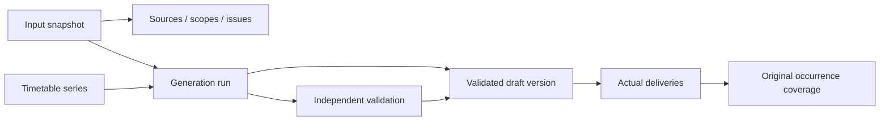

# Step 12B.1: database architecture and persistence foundation

This is a prepared, opt-in PostgreSQL persistence boundary. No database connection,
migration, import write, or timetable write was performed. Existing solver,
preparation, Excel adapters, successful timetable exports and health API remain
independent of persistence. This step adds no endpoints, background jobs or
publication/approval workflow.

## Inspection and ownership

The root README, shared `packages/db-core`, Academic Data models/migrations, and
Identity models/authorization contracts were inspected locally. This is a code
inspection, not a claim about currently deployed Neon objects.

| Owner | Authoritative records | Teaching integration |
| --- | --- | --- |
| Academic Data Service (`academic`) | Staff; administrative positions, appointments and versioned administrative workload policies. Catalog, offerings, student groups and registrations belong here architecturally; those broader masters are not implemented in the inspected service yet. | Immutable, explicitly scoped input snapshots and opaque owner references; no second staff/catalog/group database. |
| Identity Service (`identity`) | Users, authentication, institution-scoped roles and permissions. | Optional opaque `created_by_identity_user_id`; authorization stays outside the repository. Staff need not have an Identity login. |
| Resource Service | Venue inventory and authoritative shared resource reservations. | Frozen venue input and draft delivery assignments. Persisting a teaching draft does not reserve a room in another service. |
| Teaching Service (`teaching`) | Input history, solver attempts, independent assessment evidence, draft timetable versions, actual deliveries and original occurrence coverage. | Ten new service-owned tables, an isolated Alembic history, and repository ports. |
| Shared db-core | Connection settings, engines, session factories and transaction lifecycle. | Reuse the injected async session factory and `session_scope`; no extra settings parser or credential file. |

**Identifier integration:** workbook/Pydantic `staff_id` values such as `LEC001`
correspond to Academic Data's tenant-scoped `staff_number`, not its UUID `staff.id`.
`identity.users.id` is a separate identity again. The exact supplied local reference
is retained; an optional `ExternalReference.authoritative_id` records a real
owner-issued UUID only when it is actually available. Module codes remain
non-unique, including the two IT2100 records. Source-row offering references remain
local scheduling references and are never promoted to authoritative offering IDs.

Institution registry ownership is not implemented in the inspected Identity
tables. Callers must supply an authorized, nonzero institution UUID. The foundation
generates UUIDs only for Teaching-owned history records, never for academic masters.
Cross-service references intentionally have no foreign keys to another service's
tables. HOD/Dean appointments do not replace underlying academic ranks, and frozen
policy inputs retain separate teaching targets, administrative allocations,
completion evidence and campus-attendance evidence.

## Prepared PostgreSQL schema

Every domain table contains `institution_id`. All internal foreign keys carry that
tenant key and use `RESTRICT`. Mutable master records are not introduced.

| Table in `teaching` | Purpose and important constraints |
| --- | --- |
| `input_snapshots` | Version-1 typed input document, SHA-256, term reference, IANA timezone, calendar label and expected original occurrence count. |
| `snapshot_sources` | Snapshot-scoped source label/hash/owner, provenance category and source metadata; unique label per snapshot. |
| `snapshot_scopes` | Study year 1–4, semester 1–2, stream, specialization, exact local group references, optional supplied cohort count and supported/blocked state. |
| `snapshot_issues` | Scoped or snapshot-wide unresolved requirements and diagnostics, including Research and missing DS mappings. |
| `timetable_series` | Tenant-scoped logical history identity; serializes version allocation without a mutable current-version pointer. |
| `generation_runs` | Terminal OPTIMAL/FEASIBLE/UNKNOWN/INFEASIBLE/MODEL_INVALID attempts, snapshot, actual counts, runtime and complete original solver output/assessments. |
| `validation_reports` | Independent check evidence. Passed results require exact expected coverage and zero hard violations. Unsuccessful attempts have `NOT_ASSESSED`, zero checked occurrences and NULL hard-violation count, not a false zero-clash claim. |
| `timetable_versions` | Positive version number, previous-version link, successful run and passed-report foreign keys. Only `DRAFT_VALIDATED` / `COMPLETE_SUPPORTED_SCOPE`; `academic_complete` remains false. |
| `deliveries` | One actual lecturer/venue booking per delivery: date, local start/end minutes, delivery mode, original staff/venue references and student demand. Online bookings have no physical venue; physical bookings require one. |
| `delivery_coverage` | One row per original occurrence covered by a delivery. Primary key `(institution_id, version_id, occurrence_reference)` prevents duplicate fulfillment; retains requirement, offering, group, session type, duration, period, stream and specialization. |

`teaching.alembic_version` is the eleventh, migration-management table.



Versions are alternatives. There is deliberately no cross-version room/staff
exclusion constraint: two draft alternatives may use the same resource. Exact
coverage and hard clashes are independently checked inside each selected scope.
The separate Semester 1 and Semester 2 schedules are not thereby established as a
jointly conflict-free concurrent schedule. Confirmed publication and cross-service
resource reservations need a later, separate lifecycle design.

## Snapshots and provenance

`SnapshotDocument` composes existing `TeachingTimetableInput`, `SolverConfig`,
`PreferenceCalendar`, combination, venue, staff, workload/protection, preferences,
fairness, consecutive-session and student-lunch contracts. No replacement student,
offering or session schemas were created. Optional features must supply their
complete original context; effective default options should be materialized when
capturing an older caller that previously omitted them.

Group specialization is explicit metadata because the existing `StudentGroup`
contract intentionally does not own that field. Each supplied group belongs to
exactly one compatible supported scope. Blocked scopes carry their supplied counts
without fabricated groups or modules. Counts are not summed over a hierarchy as
though parents and children were distinct student populations.

Source categories are independent:

- `UNIVERSITY_SOURCED`: accepted academic/staff/venue workbook inputs.
- `APPROVED_PP1_ESTIMATE`: approved proportional specialization allocations, with
  their original aggregate-total reconciliation evidence.
- `SYNTHETIC_PP1`: reproducible elective registrations, registration rules and seed.
- `EXPERIMENTAL_CONFIGURATION`: the 18:30 Weekend Monday online calendar extension.
- `USER_CONFIRMED_CORRECTION`: subsequent campus-confirmed location metadata while
  retaining the original workbook status and provenance.
- `SERVICE_EXPORT`: other explicitly identified service artifacts.

Each source needs an exact SHA-256 and provenance metadata. Workbook/sheet/row,
column mappings, original statuses and later confirmations can be retained in
that metadata or referenced by the frozen document. Existing university-provided
records do not need to be re-confirmed for this step. Whole input hashing never
replaces individual source-workbook checksums.

The snapshot's JSONB `payload` contains an exact `document_json` string. This
preserves original map ordering used by some existing report snapshot comparisons,
despite PostgreSQL JSONB reordering object keys. SHA-256 binds the whole envelope,
including that exact string. Relational scope/source columns provide searchable
metadata without duplicating academic masters. Canonical JSON helpers sort
unordered sets/maps for digests while retaining array order and exact source text.
Reads verify the envelope digest and expected demand before reconstructing native
contracts. No pickled solver/prepared objects are persisted.

Research remains compulsory and unresolved through
`RESEARCH_PENDING_SESSION_MAPPING`; its source representation
`COMPULSORY_RESEARCH_PENDING_SESSION_MAPPING` can be retained in issue details.
No zero-hour Research requirement is invented. Year 4 Semester 1 DS retains
`BLOCKED_MISSING_ACADEMIC_MAPPING` and the 148 allocated students across its two
streams. A caller capturing those PP1 inputs must carry both issues and blocked
scope counts in its snapshot. Successful known-scope teaching coverage does not
close either academic gap.

## Repository and validation boundary

`persistence/ports.py` provides database-independent `SnapshotRepository` and
`TimetableRepository` protocols and immutable receipts/version summaries.
`SqlTeachingRepository` implements snapshot storage/loading, series creation,
version listing and append-only terminal attempt recording. Methods never commit.
`teaching_unit_of_work(factory, institution_id)` uses shared db-core to commit a
successful unit or roll it back and close the session on failure/cancellation.
No engine/session factory is created by an import or by the FastAPI application.

The future application flow is:

1. Validate Excel/service exports with existing adapters and contracts; attach
   source evidence and unresolved requirements, then store an immutable snapshot.
2. Read/replay that snapshot into existing pure preparation and CP-SAT inputs.
   Close the database transaction before a long solve; never hold database locks
   for CP-SAT execution.
3. Start a new unit of work, reload the snapshot and pass the native `SolverResult`
   to `append_attempt`. It reruns the existing independent validation gateway
   against original input contexts before any history rows are added.
4. Record an unsuccessful terminal attempt without a timetable version, or append
   a complete validated draft version and its delivery/coverage rows atomically.
5. A later authorized API can read version summaries and exports. API wiring and
   ingestion orchestration are intentionally outside this foundation.

The repository locks its series row to allocate monotonically increasing version
numbers and compares `expected_previous_version_id` to reject stale appenders.
One combined delivery produces one booking and multiple unique original coverage
rows. Mixed and separate results retain their exact coverage. Administrative
reservations, recognized work, objective stage/status history and independent
assessments remain in the original result JSON; an allocation/reservation is not
recorded as proof of completed administrative work.

Physical draft persistence requires validated venue allocation. The existing
earlier solver modes can still run without venues; this stricter persistence gate
does not change their behavior. Incomplete/corrupt feasible outputs are rejected
before inserting a run or draft. The future application should separately record
sanitized generation/validation exceptions as operational failure diagnostics.

## Migration and isolation review

Prepared revision `20261016_0001` uses frozen PostgreSQL DDL in its adjacent `.sql`
asset, independent of later ORM edits. `migrations/env.py` isolates reflection and
the version table to `teaching`. The offline path uses a dialect-only URL and reads
no database settings. The online path, for a later approved application, reuses
db-core's direct async connection and Windows-compatible runtime helper.

All ten domain tables receive enabled **and forced** row-level security, using a
transaction-local `schedence.institution_id` setting with matching `USING` and
`WITH CHECK` predicates. Missing/empty tenant context returns no matching rows;
invalid UUID context fails closed. Repository reads also filter explicitly by
institution. UPDATE/DELETE triggers reject mutation of historical rows. The
revision creates no roles, cross-service foreign keys or grants. Its explicit
downgrade removes only these tables and its trigger function, without `CASCADE`
or dropping a service schema. Downgrade is destructive and was rendered only.

Deployment must use a trusted runtime role without superuser/BYPASSRLS privileges,
separate from the migration role. Runtime needs SELECT/INSERT and the narrow
UPDATE privilege PostgreSQL requires for `SELECT FOR UPDATE` on `timetable_series`;
the immutability trigger still rejects actual row updates. Tenant context must
come from authorized server-side Identity scope, never an unchecked request value.
RLS is not a substitute for authenticating that scope.

Exact coverage, venue suitability, student hierarchy, staff eligibility and time
clashes remain application-validator guarantees. A privileged direct SQL writer
could bypass that gate; table constraints alone do not prove timetable validity.
Offline compilation and fake-session tests do not prove live PostgreSQL/RLS
behavior. A disposable PostgreSQL integration test is required before deployment.

## Reproduction without connecting to Neon

Optional installation, from the repository root:

```powershell
.\.venv\Scripts\python.exe -m pip install -e ./packages/db-core
.\.venv\Scripts\python.exe -m pip install -e './services/teaching-service[persistence,dev]'
```

Checks used for this foundation:

```powershell
.\.venv\Scripts\python.exe -m pytest services/teaching-service/tests -q
.\.venv\Scripts\python.exe -m pip check
.\.venv\Scripts\python.exe -m alembic -c services/teaching-service/alembic.ini upgrade head --sql
```

The final command **renders SQL only**; omitting `--sql` would execute migrations
and is not authorized in this step. Offline tests render upgrade/downgrade with
db-core settings/engine creation deliberately patched to fail. Prepared ORM DDL
and indexes are checked against the frozen revision asset. Tests also cover
snapshot corruption/mutation, tenant boundaries, atomic rollback, stale versions,
unknown/infeasible attempts, duplicate coverage, online and physical delivery,
mixed combinations, all joint workload/protection/preference/fairness/consecutive
features, and confirmed student lunch replay. Synthetic fixtures contain no real
staff records. Verification passed **2,390 tests** (83 new); `pip check` reported
no broken requirements. The only suite warning is the existing Starlette/httpx
deprecation. All 1,096 pre-existing files remain present, all seven workbooks and
earlier private artifacts are byte-identical, and only README/pyproject changed
among the pre-existing files. Private SQL review and preservation manifests are
under `local-data/persistence-preview/step12b1/`.

## Files affected

All paths are relative to `services/teaching-service/`.

Created:

- `src/schedence_teaching/persistence/__init__.py`
- `src/schedence_teaching/persistence/contracts.py`
- `src/schedence_teaching/persistence/models.py`
- `src/schedence_teaching/persistence/ports.py`
- `src/schedence_teaching/persistence/repositories.py`
- `src/schedence_teaching/persistence/snapshots.py`
- `alembic.ini`
- `migrations/env.py`
- `migrations/script.py.mako`
- `migrations/versions/20261016_0001_teaching_history.py`
- `migrations/versions/20261016_0001_teaching_history.sql`
- `tests/test_persistence_contracts.py`
- `tests/test_persistence_repositories.py`
- `tests/test_persistence_migrations.py`
- `docs/step-12b1-persistence-foundation.md`

Modified: `pyproject.toml` (optional persistence dependencies) and `README.md`
(foundation link and limits). Alembic 1.20.0 was installed in the existing virtual
environment; shared db-core, SQLAlchemy and psycopg were already present. Local
preservation/verification JSON and rendered SQL are ignored private review
artifacts, not new academic source files.

## Decisions before applying anything

1. Approve Teaching's schema/history boundary, snapshot retention and draft-only
   lifecycle. Confirm live schema availability and choose the deployment migration
   owner; no deployed schema inspection was performed here.
2. Supply the institution registry/authorized tenant source and real owner-ID
   mappings where available. Retain local source references until authoritative
   catalog/group/registration services provide their IDs. Do not fabricate them.
3. Review runtime/migration roles, RLS behavior, grants and isolated PostgreSQL
   integration tests. Define authorization for `teaching:generate` and eventual
   `teaching:approve` in the application layer.
4. Define restricted access, encryption, retention and authorized deletion for
   snapshots containing staff/preference/registration information. The proposed
   immutable history deliberately provides no application delete method.
5. Define future publication/resource-reservation integration and active-semester
   concurrency scope. Draft alternatives must not claim globally reserved venues
   or an approved concurrent multi-semester timetable.
6. Agree on generation job/failure recording, idempotent retries, algorithm/build
   version provenance and API/readback/export contracts before production use.
   This foundation accepts terminal native results, not a running job queue or a
   decoder that reconstructs every historical native result dataclass from JSON.
7. Keep the experimental calendar, missing DS mapping and unresolved compulsory
   Research visible. Those are existing scheduling/integration boundaries, not
   reasons to discard the successful supported-scope schedules.
